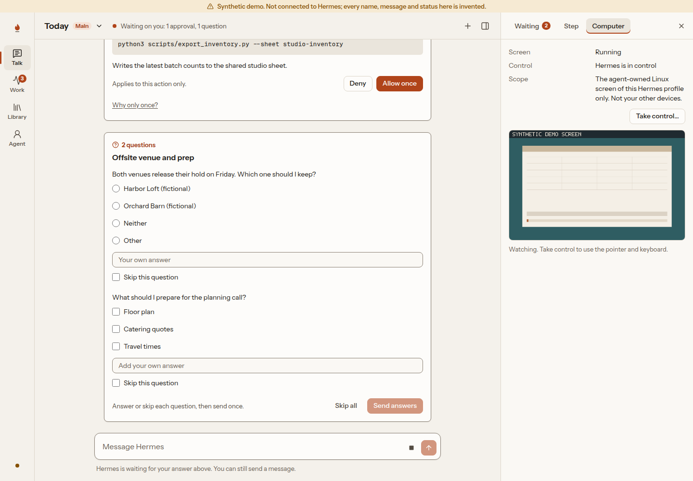
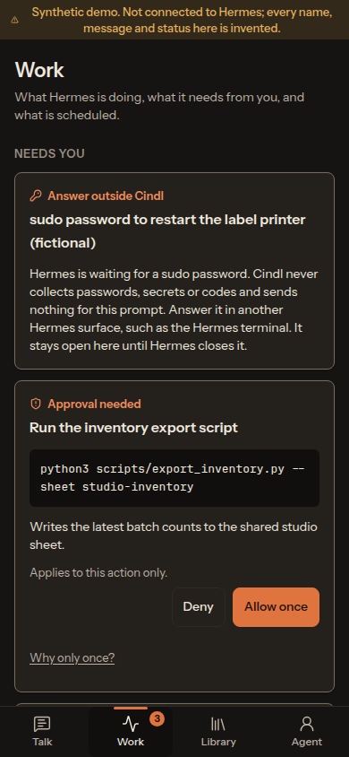

<div align="center">
  

# Cindl

### A calm home for your self-hosted Hermes agent, on the web, desktop and Android

[](https://github.com/FlintSH/cindl/releases)
[](https://github.com/FlintSH/cindl/actions/workflows/ci.yml)
[](#quick-start)
[](LICENSE)

</div>

Cindl (pronounced _sin-dəl_) is a client for one person's
[Hermes Agent](https://github.com/NousResearch/hermes-agent). Talk to your
always-on agent, see what it is working on, answer what it needs from you, and
look after who it is and what it can reach, from your browser, your desktop or
your phone.

Hermes stays the brain. Cindl connects to your existing `hermes serve` and
signs in through Hermes's own sign-in. It adds no model, no API keys, no
accounts, no analytics and no hosted service.

## Features

- 💬 **Conversations first.** A main conversation and side conversations, with
  Hermes's replies streamed as they come. You can keep sending while Hermes
  works.
- ✅ **Approvals and questions.** What Hermes needs from you shows in the
  conversation and in Work, and each one is answered once: allow it once or
  deny it. Cindl never sends a standing grant.
- 🧭 **The working margin.** Beside each conversation: what it waits on, the
  step you selected, and the agent's computer. It is a column on wide screens
  and a sheet on phones.
- 🖥️ **The agent's computer.** Watch the agent-owned screen live, take control
  when you need to, and hand it back. Only the screen Hermes manages for its
  own profile, never your other devices.
- 📚 **Skills, memory and SOUL.** Read and edit skills, memory entries and
  `SOUL.md`, each edit after reviewing a diff and against the version you
  read.
- 🔒 **Your Hermes only.** Cindl talks to the Hermes you connect it to and
  nothing else. Tokens stay in the system keyring on the desktop (in memory
  only where there is none) and in the Android Keystore; the web client uses
  Hermes's own session cookie.

<div align="center">
  
  
</div>

<p align="center"><sub>Screenshots use the labelled synthetic demo, not real data.</sub></p>

## Quick start

You need a Hermes that runs `hermes serve` with a sign-in provider (password,
Nous Portal or your own OIDC). Cindl is verified against Hermes v0.22.5; newer
versions connect and show as outside that baseline.

**Desktop (Linux and Windows)**

1. Download `Cindl-x.y.z-x86_64.AppImage` (Linux) or `Cindl-Setup-x.y.z.exe`
   (Windows) from the [latest release](https://github.com/FlintSH/cindl/releases/latest).
2. On Linux, make the AppImage executable and run it. On Windows, the installer
   is not code-signed, so SmartScreen asks first: choose **More info**, then
   **Run anyway**.
3. Enter your Hermes address and sign in. Hermes's own sign-in page opens in
   your browser, so Cindl never sees your password.

**Android (7.0 or later)**

1. Download `Cindl-x.y.z.apk` from the [latest release](https://github.com/FlintSH/cindl/releases/latest)
   and open it on your phone. Allow installs from your browser if Android asks.
2. Enter your Hermes address and sign in. Hermes's sign-in page opens in a
   browser tab.

**Web**

The web client is served by your Hermes host at `/cindl/`, so it signs in with
Hermes's own cookie. Setting that up is a few steps for whoever runs Hermes:
see [Running Cindl](docs/handbook/operations/index.md).

### Verify a download

Every release lists SHA-256 checksums in `SHA256SUMS`. The Android APK is
signed with this certificate:

```text
SHA-256: A4:10:5F:20:F7:FA:59:01:03:5E:B0:8D:B2:2E:02:CC:84:02:B9:22:F5:9D:77:D7:9E:53:2A:92:0E:2B:B9:B6
```

Check it with `apksigner verify --print-certs Cindl-x.y.z.apk`. Android also
refuses to update Cindl with an APK signed by a different key. The AppImage and
the Windows installer are not code-signed; check them against `SHA256SUMS`.

Releases are tagged `vX.Y.Z` from `main`. Each one is built by CI from that
exact commit, after the same checks every change passes.

## Documentation

- **Use Cindl:** [Web](docs/handbook/clients/web.md) ·
  [Desktop](docs/handbook/clients/desktop.md) ·
  [Android](docs/handbook/clients/android.md)
- **Run it:** [Serving the web client](docs/handbook/operations/index.md) ·
  [Security](SECURITY.md) · [Threat model](docs/handbook/security/threat-model.md)
- **How it is built:** [Architecture](docs/handbook/architecture/overview.md) ·
  [Decisions](docs/handbook/architecture/decisions/README.md) ·
  [Acceptance matrix](docs/handbook/project/acceptance-matrix.md)
- **Work on Cindl:** [Getting started](docs/handbook/development/getting-started.md) ·
  [`AGENTS.md`](AGENTS.md) · [Design](DESIGN.md)

## Support

Questions, ideas or problems: open an [issue](https://github.com/FlintSH/cindl/issues).
Report security problems as [`SECURITY.md`](SECURITY.md) describes.

## License

Cindl is licensed under the [MIT License](LICENSE).
Copyright (c) 2026 Zachary Lowery

It bundles the Instrument Sans and JetBrains Mono fonts (SIL OFL 1.1) and an
excerpt of the Hermes contract (MIT, Nous Research); see
[third-party notices](THIRD_PARTY_NOTICES.md).
